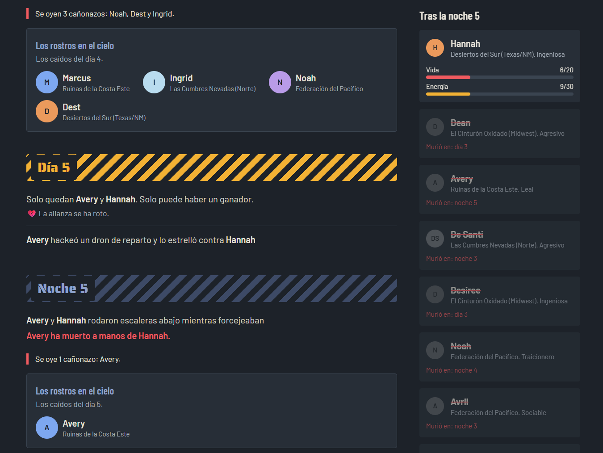
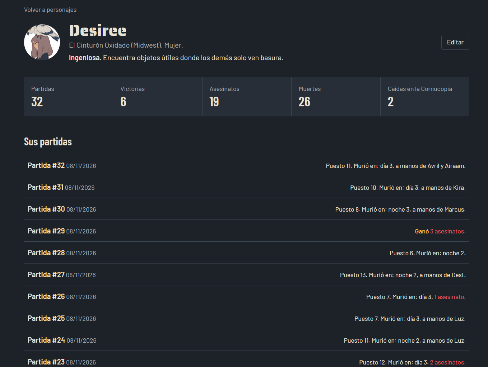
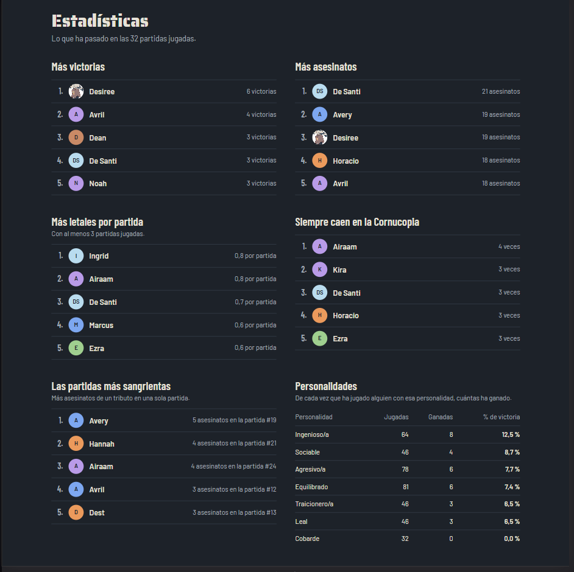
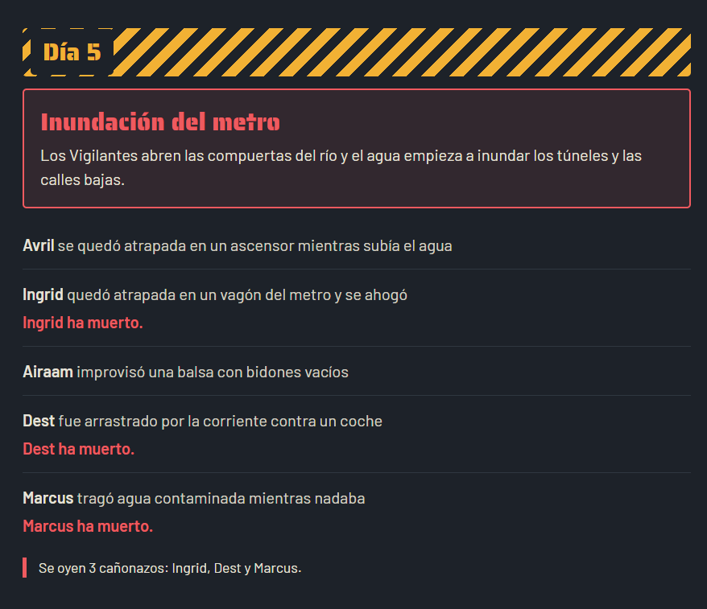
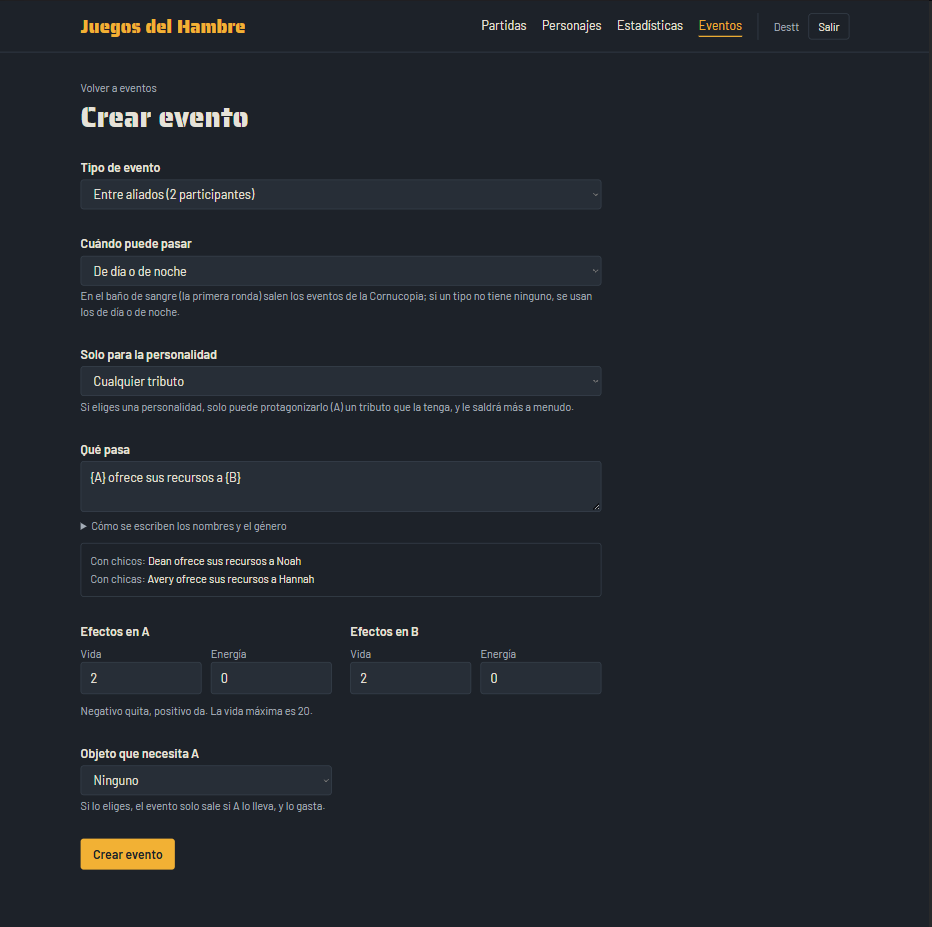

# Juegos del Hambre: simulador


Un simulador de los Juegos del Hambre ambientado en una Norteamérica futurista en ruinas, al estilo del simulador de Brantsteele, pero con reglas de verdad: si un tributo encuentra un botiquín, lo lleva en la mochila y lo usa cuando está herido; si se hace aliado de otro, ya no se atacan... hasta que uno de los dos le traiciona.

Empezó como un proyecto en Java que dejé a medias y lo he rehecho desde cero en Laravel para practicar el stack que uso en mis prácticas.



## Qué hace

- **Partidas ronda a ronda.** El baño de sangre en la Cornucopia, y después días y noches alternos. Al final de cada noche se proyectan en el cielo los rostros de los caídos.
- **488 eventos** con concordancia de género («Avery fue herida», «Dean y Noah, juntos»), filtrados por fase del día, por objetos que hacen falta y por la personalidad de quien los protagoniza.
- **Objetos que funcionan**: 22 armas, defensas, curas y bebidas, con usos limitados. Las defensas absorben daño y los consumibles se usan solos cuando hacen falta.
- **Alianzas** que se forman, atacan juntas y se rompen con traiciones. Los compañeros de distrito se alían con más facilidad.
- **Personalidades** (agresivo, cobarde, leal, traicionero, ingenioso, sociable) que cambian las probabilidades y tienen sus propios eventos.
- **8 catástrofes de los Vigilantes**: inundaciones, tormentas de ácido, sueltas de mutos... que afectan a todos los tributos a la vez.
- **4 arenas**: la ciudad en ruinas, el desierto de sal, las cumbres heladas y los pantanos, cada una con sus propios eventos y catástrofes.
- **Reglas especiales**: cada uno por su cuenta, juego de traidores, armados hasta los dientes, al límite, escasez... o el **Vasallaje de los 25**, en el que el Capitolio elige dos por sorpresa.
- **Patrocinadores**: envía hasta 3 regalos por partida a tus favoritos. La partida se vuelve a jugar desde ese momento, sin cambiar lo que ya has visto.
- **Estadísticas**: quién mata a quién, némesis y rivalidades, tu porcentaje de acierto en las apuestas, victorias por personaje, distrito y personalidad, y las partidas más sangrientas.
- **Editor de eventos** con vista previa en directo, y personajes con foto.
- **Usuarios** con sus propios personajes y partidas.

| | |
|---|---|
|  |  |
|  |  |

## Stack

- **Laravel 13** y **PHP 8.4**
- **PostgreSQL**, con columnas `jsonb` para el registro de cada ronda
- **Blade** y **Tailwind CSS 4**, sin frameworks de JavaScript
- **PHPUnit** para los tests, **Pint** para el formato y **Larastan** para el análisis estático, los tres en **GitHub Actions**

## Cómo funciona por dentro

El **motor** (`app/Simulation`) es PHP puro, sin base de datos, y por eso se puede probar en milisegundos:

- `Tribute` guarda el estado de cada tributo durante la partida: vida, energía, mochila y alianzas.
- `EventPool` elige qué evento puede ocurrir según la categoría, la fase, los objetos y la personalidad.
- `EventResolver` aplica un evento: daño, defensas, objetos, alianzas, consumibles y quién mata a quién.
- `Simulation` juega las rondas.

El azar tiene **semilla**: la misma semilla y los mismos tributos dan siempre la misma partida. Cada ronda tiene su propio azar, calculado a partir de la semilla y del número de ronda. Así se puede guardar el estado al final de cualquier ronda y continuar desde ahí, que es lo que usan los patrocinadores.

Alrededor del motor, Laravel se encarga del resto: `PlayGame` y `ResumeGame` (en `app/Actions`) juegan y guardan las partidas, las *policies* controlan quién puede ver qué, y los Form Requests validan los formularios.

## Instalación

Hace falta PHP 8.4, Composer, Node.js y PostgreSQL.

```bash
git clone https://github.com/luisfa2117-pixel/juegos-hambre.git
cd juegos-hambre

composer install
npm install && npm run build

cp .env.example .env
php artisan key:generate
```

Crea una base de datos en PostgreSQL y pon sus datos en el `.env` (`DB_DATABASE`, `DB_USERNAME`, `DB_PASSWORD`). Después:

```bash
php artisan migrate --seed
php artisan storage:link
php artisan serve
```

Abre http://127.0.0.1:8000 y entra con la cuenta de pruebas: **demo@juegos.test**, contraseña **password**. Tiene 12 personajes listos para jugar.

También puedes ver una partida entera en la terminal:

```bash
php artisan simulate --seed=42
```

## Tests y calidad

```bash
php artisan test                                   # más de 180 tests
vendor/bin/pint --test                             # formato
vendor/bin/phpstan analyse --memory-limit=1G       # análisis estático
```

Los tests del motor comprueban, entre otras cosas, que la misma semilla da la misma partida, que una partida reconstruida desde una ronda guardada termina exactamente igual que la original, y que cada personalidad se comporta como debe a lo largo de cientos de partidas.

## Los eventos

Los eventos están en [`database/data/eventos.json`](database/data/eventos.json) y se cargan con los seeders. Se pueden editar desde la web y volcar de nuevo al JSON con:

```bash
php artisan events:export
```
